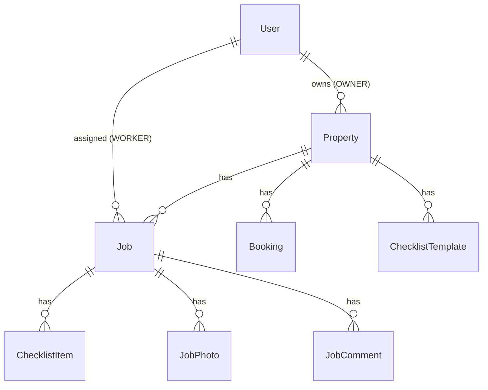

# Architecture

## Overview

```
apps/web         Next.js (App Router), Tailwind, TanStack Query, next-intl
apps/api         NestJS, Prisma, PostgreSQL
packages/shared  Pure TypeScript types, enums and constants used by both
```

A pnpm workspace, with no Nx or Turborepo. `packages/shared` contains **types and
constants only, no runtime logic**; API DTOs `implement` its interfaces.

## Request flow

```
browser ──► web (Next.js) ──/api/* rewrite──► api (NestJS) ──► PostgreSQL
                                                   └──► uploads volume (photos)
```

The browser never calls the API directly. Next.js rewrites `/api/*` to the
API, so everything is same-origin. This is deliberate:

- Auth uses **httpOnly cookies**, so tokens are never readable by JavaScript.
- Photos load with a plain ``, and the cookie
  authorises the request. (`next/image` optimisation would break this.)
- There's no CORS configuration, and SameSite=Lax cookies cover cross-site requests.

## Authentication

- Short-lived access JWT (15 min) plus a rotating refresh token (14 days, stored
  hashed). The refresh cookie is scoped to `/api/auth`.
- The web client retries once on `401` after a single shared refresh call.
- `JwtAuthGuard` authenticates; `@Roles()` + `RolesGuard` authorise.
- Passwords are hashed with argon2. Accounts are invite-only.

## Data model



## Core rules and where they live

| Rule | Location |
|---|---|
| Job status transitions, by role, with required reasons | `apps/api/src/jobs/job-status.machine.ts`, the single source of truth. The API returns `allowedTransitions` per job and the UI renders only those. |
| Finishing requires a complete checklist and required photos | `JobsService` transition guard |
| Visibility: workers see assigned jobs, owners see jobs on their properties | `scopeFor` / `jobScope` in the jobs, comments and photos services |
| Owners only see `SHARED` comments, and their own comments are forced to `SHARED` | `apps/api/src/comments/comments.service.ts` |
| Turnover cleaning suggestion and tight-gap detection | `apps/api/src/bookings/turnover-suggestion.ts` (pure function) |
| Checklist templates are **snapshot-copied** onto jobs | Job creation; editing a template never rewrites history |

## Photos

Uploads are checked by content (magic bytes), not by extension (JPEG, PNG
or WebP, at most 15 MB), stored under a random UUID filename through a `StoragePort`
(local disk today, swappable for object storage), and streamed back only after a
permission check with `Cache-Control: private`. The web client downsizes images
to at most 1920 px before upload.

## Time

Timestamps are stored in UTC and displayed in `Europe/Zagreb`
(`DISPLAY_TIMEZONE` in `packages/shared`). Agenda grouping uses the local day.

## Internationalisation

Every user-facing string is a key in `apps/web/messages/en.json`, read through
next-intl. There's no locale routing yet.
