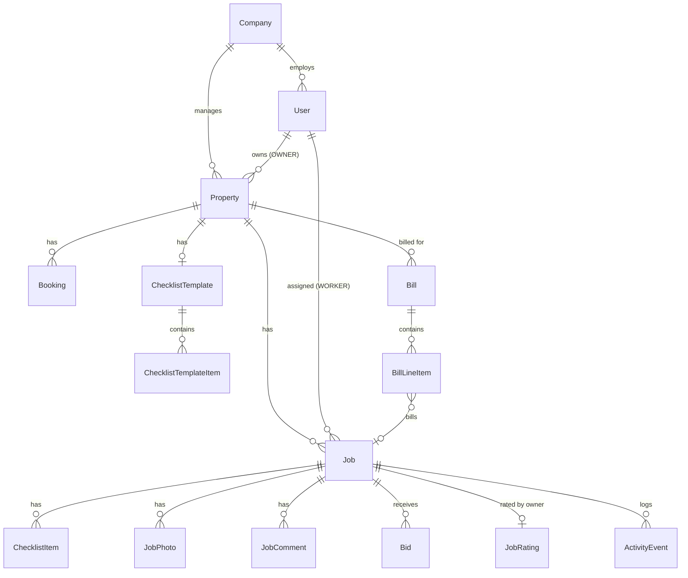

# Architecture

## Overview

```
apps/web            Next.js (App Router), Tailwind, TanStack Query, next-intl
apps/api            NestJS, Prisma, PostgreSQL
apps/worker-mobile  Worker app: Vite + React + react-router, wrapped by Capacitor
packages/shared     Pure TypeScript types, enums and constants used by all three
```

A pnpm workspace, with no Nx or Turborepo. `packages/shared` contains **types and
constants only, no runtime logic**; API DTOs `implement` its interfaces.

The worker app reuses the web app's worker components and `lib/` (copied into
`apps/worker-mobile/src`, with `next/link` and `next/navigation` aliased to
react-router shims).

## Request flow

```
browser ───────────► web (Next.js) ──/api/* rewrite──► api (NestJS) ──► PostgreSQL
worker app ──https──►      │                               └──► uploads volume
                     (same /api/* rewrite)
```

**The web app is same-origin by design.** The browser calls relative
`/api/...` paths, and Next.js forwards them to the API.

- Auth uses **httpOnly cookies**, so tokens are never readable by JavaScript.
- Photos load with a plain ``, and the cookie
  authorises the request. (`next/image` optimisation would break this.)

**The worker app is cross-origin.** It calls an absolute `VITE_API_BASE`
with **Bearer tokens**: it sends `X-Client: mobile` at sign-in and gets the
tokens in the response body. Tokens are kept in the device's secure storage.

- The API's CORS allow-list always includes the Capacitor origins
  (`capacitor://localhost`, `http://localhost`, `https://localhost`), plus
  anything in `CORS_ORIGINS`.
- Credentials aren't allowed cross-origin, so cookies are never sent that way.

## Authentication

- Short-lived access JWT (15 min) plus a rotating refresh token (14 days, stored
  hashed). For the web app, the refresh cookie is scoped to `/api/auth`.
- Both clients retry once on `401` after a single shared refresh call.
- `JwtAuthGuard` authenticates; `@Roles()` + `RolesGuard` authorise by role.
- Passwords are hashed with argon2, and emails are stored lowercase.
- Accounts are invite-only. The first supervisor of a company is created by a
  platform admin.

## Multi-tenancy

Every tenant-owned record carries a `companyId`, and isolation is enforced in
one place rather than in every query:

- `TenantContextMiddleware` opens an AsyncLocalStorage context per request, and
  `JwtAuthGuard` fills it with the user's `companyId`.
- A Prisma client extension (`apps/api/src/prisma/tenant.extension.ts`) adds
  `companyId` to the `where` of reads and `*Many` operations, and to the data
  of creates, for User, Property, Job, Bill, BillLineItem, Booking, Invite and
  Bid. `findUnique`, `update`, `delete` and `upsert` can't be scoped this way,
  so their call sites check ownership explicitly.
- Child records (photos, comments, checklist items, ratings) have no
  `companyId`; they're only ever reached through a scoped parent.
- It **fails closed**: an authenticated non-admin request without a company
  throws.
- **Platform admins** (`User.isPlatformAdmin`, no company) bypass scoping and
  use the separate `/api/admin/*` endpoints guarded by `PlatformAdminGuard`.
- **Seat licensing** (`apps/api/src/license`): active supervisors and workers,
  plus pending invites for them, may not exceed `Company.maxSeats`.
- Suspending a company revokes its refresh tokens and blocks sign-in.

## Data model



Also: `Invite`, `RefreshToken` and `DeviceToken` (push).

## Core rules and where they live

| Rule | Location |
|---|---|
| Job status transitions, by role, with required reasons | `apps/api/src/jobs/job-status.machine.ts`, the single source of truth. The API returns `allowedTransitions` per job and the UI renders only those. |
| Initial status: negotiable → `OPEN`, with worker → `ASSIGNED`, otherwise `DRAFT` | `JobsService.create` |
| Only drafts are editable; the price can change while `DRAFT` or `ASSIGNED` | `JobsService.update` |
| Finishing requires a complete checklist and required photos | `JobsService` transition guard |
| Accepting a bid assigns the job at the bid's price and rejects the others, in one transaction | `apps/api/src/bids/bids.service.ts` |
| Visibility: workers see assigned jobs, owners see jobs and confirmed bills for their properties | Scope helpers in the jobs, comments, photos and bills services |
| Owners only see `SHARED` comments, and their own comments are forced to `SHARED` | `apps/api/src/comments/comments.service.ts` |
| Bills: only verified, priced jobs; confirmed bills are numbered and immutable | `apps/api/src/bills/bills.service.ts` |
| Turnover cleaning suggestion and tight-gap detection | `apps/api/src/bookings/turnover-suggestion.ts` (pure function) |
| Checklist templates are **snapshot-copied** onto jobs | Job creation; editing a template never rewrites history |

## Money

Amounts are integers in minor units (cents). Job prices are net. A bill holds
a single currency and an optional VAT rate in basis points (1900 = 19%).
Hourly lines store quantity in hundredths of an hour. Bill PDFs are rendered
server-side with pdfkit.

## Photos

Uploads are checked by content (magic bytes), not by extension (JPEG, PNG
or WebP, at most 15 MB), stored under a random UUID filename through a `StoragePort`
(local disk today, swappable for object storage), and streamed back only after a
permission check with `Cache-Control: private`. Clients downsize images to at
most 1920 px before upload. Avatars use the same storage.

## Push notifications

`NotificationsService` sends through Firebase Cloud Messaging when
`FIREBASE_SERVICE_ACCOUNT` is set, and only logs otherwise. Devices register
through `POST /api/devices`. The only event that sends a notification today is
a new comment on a worker's job.

## Worker app offline mode

The worker app persists the TanStack Query cache in Capacitor Preferences, and
queues writes (status changes, checklist ticks, comments, photo uploads) in a
durable outbox that replays in order on reconnect (`apps/worker-mobile/src/lib/outbox.ts`).

## Time

Timestamps are stored in UTC and displayed in `Europe/Zagreb`
(`DISPLAY_TIMEZONE` in `packages/shared`). Agenda grouping uses the local day.

## Internationalisation

UI strings are keys in `apps/web/messages/en.json` and
`apps/worker-mobile/src/messages/en.json`, read through next-intl. There's no
locale routing yet, and bill PDF labels are English.
