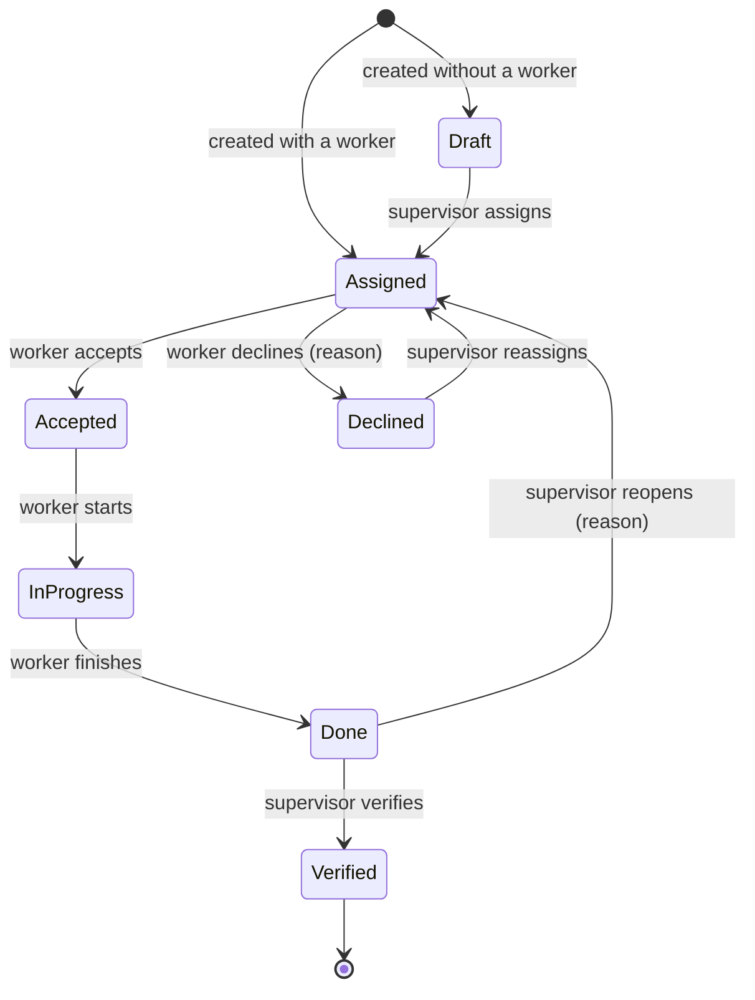

# How a job moves through Domar

Every piece of work, whether a cleaning, a repair or an inspection, is a
**job**. A job always has one status, and only certain people can move it
to the next one. Domar shows you only the actions you're allowed to take
right now.

| Status | Meaning | Next step is up to |
|---|---|---|
| **Draft** | Planned, but nobody is assigned yet | Supervisor |
| **Assigned** | A worker has been asked to do it | Worker: accept or decline |
| **Accepted** | The worker has confirmed | Worker: start |
| **Declined** | The worker can't do it, and gave a reason | Supervisor: reassign |
| **In progress** | The worker is on site | Worker: finish |
| **Done** | The worker has finished; waiting for review | Supervisor: verify or reopen |
| **Verified** | Reviewed and approved | (final) |
| **Cancelled** | Called off | (final) |

A few rules worth knowing:

- **Declining and reopening need a reason.** The reason is shown to the next
  person who handles the job.
- **A job can't be finished until its checklist is complete.** Every item must be
  ticked, and items marked *Photo required* need at least one photo.
- **Supervisors can cancel** any job that isn't done yet.
- **Drafts and declined jobs need attention.** They appear in a highlighted
  strip on the supervisor dashboard until someone is assigned.
