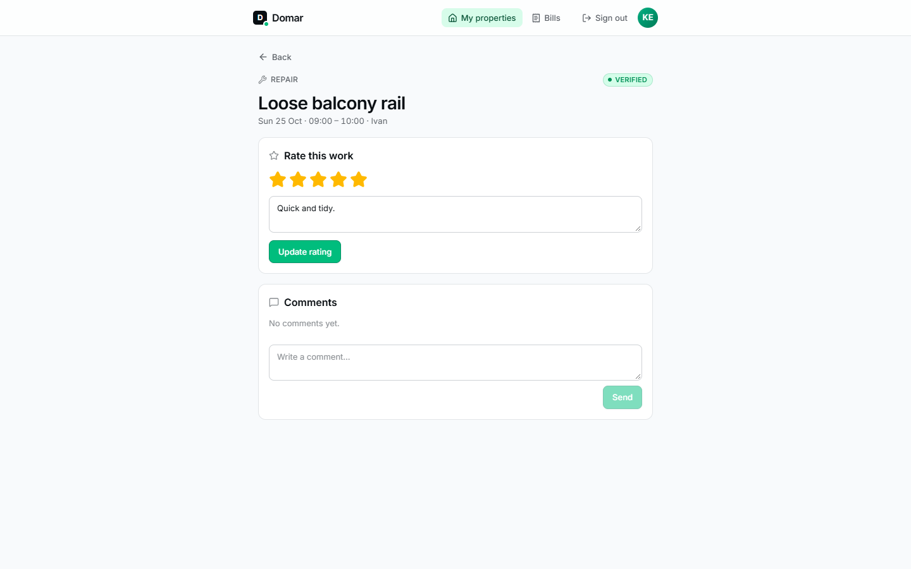

# Guide for property owners

Domar lets you follow the care of your property without having to ask.

The menu: **My properties** and **Bills**.

## Your properties

After signing in you see **My properties**: every property linked to your
account. If the list is empty, ask your property-care company to link your
property to your account.

## Work history

Open a property to see its **work history**: cleanings, repairs and
inspections, with date, status and the first name of the person who did the
work. Planned work shows up too, so you can see what's coming.

Open a job to see its photos (before, after, and any issues the worker
found) and the comments.

A job marked **Verified** has been reviewed and approved by a supervisor.
See [How a job moves through Domar](job-lifecycle.md) for what the other
statuses mean.

## Rating the work

Once a job is done, you can **rate it** from one to five stars and add a note
for the team. You can change your rating later. Ratings help the company see
how each worker is doing.

## Talking to the team

You can add a comment to any job on your property, for example to ask a
question or report something you noticed. Your comments are seen by the
supervisor and the worker on that job.

The team can also leave internal notes among themselves; those aren't shown
to you.

## Bills

**Bills** lists the bills your property-care company has issued to you. Open
one to see each job and extra cost, the net amount, VAT and total, and select
**Download PDF** for your records. A property's page also lists its bills.

Bills only appear here once they're final; drafts are never shown.

## What you can't do (yet)

You can't request new work or change property details in Domar. For those,
contact your property-care company directly.
