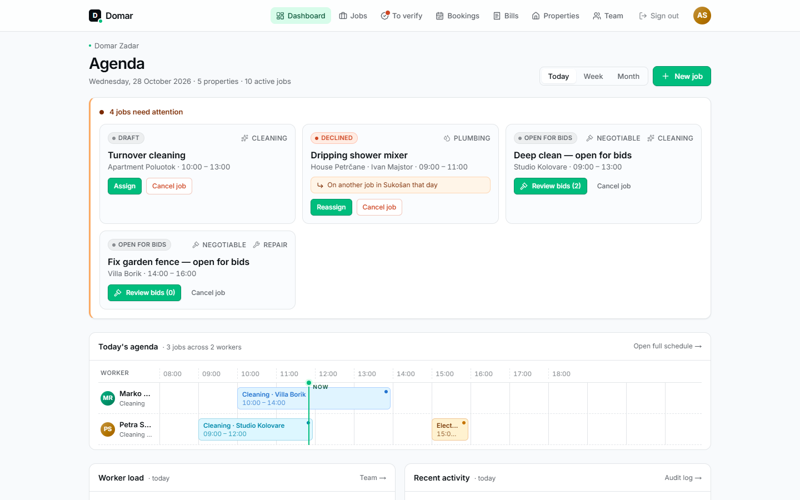
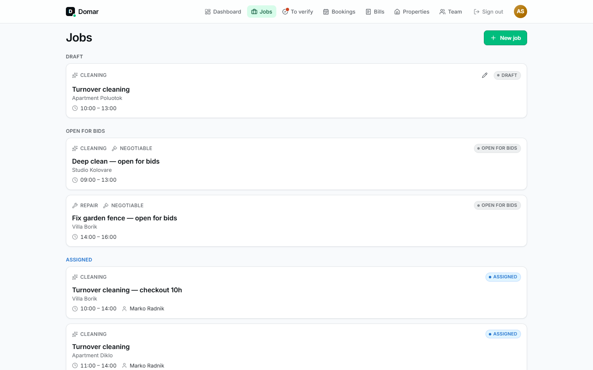

# Guide for supervisors

As a supervisor you plan the work, keep the team busy, decide when a job is
really done, and bill the owners.

The menu: **Dashboard**, **Jobs**, **To verify**, **Bookings**, **Bills**,
**Properties**, **Team**. A red dot on *To verify* means finished work is
waiting for you.

## Dashboard

The dashboard (*Agenda*) has three views: **Today**, **Week** and **Month**.

**Today** shows:

- **Jobs that need attention**: drafts without a worker, declined jobs (with the
  worker's reason) and jobs open for bids. Assign, reassign, review bids or
  cancel right from the card.
- **Today's agenda**: a timeline with one row per worker, so you can see who is
  where and spot gaps.
- **Worker load**: how many jobs each worker has today.
- **Recent activity**: the latest status changes across all jobs.

**Week** shows a timeline for each of the next seven days. **Month** shows a
calendar with up to three jobs per day.

## Jobs

**Jobs** lists every active job grouped by status (draft, open for bids,
assigned, and so on), soonest first. Verified and cancelled jobs are left out.

### Creating a job

**New job** → pick the property, the type (cleaning, repair, electrical,
plumbing, gardening, inspection, other), a title, an optional description,
and the date and time window.

When you choose a worker, Domar helps you:

- **Skill filter:** only workers qualified for the job type are offered.
  Inspections and "other" jobs can go to anyone.
- **Conflict hint:** if that worker already has a job in the same time window,
  you'll see which one. This is a warning only; you can still assign.

Choose **Leave unassigned (draft)** to save the job and assign it later.

Cleaning jobs get a copy of the property's cleaning checklist when they're
created. Later changes to the checklist don't affect existing jobs.

### Pricing

Each job can have a price, which is used for billing and shown to the worker:

| Pricing | What you enter | Billed as |
|---|---|---|
| **No price** | nothing | Not billable |
| **Fixed price** | Amount and currency | The amount |
| **Per hour** | Hourly rate; estimated hours are optional | Rate × the hours the worker logs when finishing |
| **Negotiable (open for bids)** | nothing | The accepted bid |

Prices are net (without VAT); VAT is added on the bill.

### Bids

A job created as **Negotiable** opens for bids. Workers with matching skills
see it under *Bids* and propose a fixed or hourly price, with a message if they
like.

Open the job, or use **Review bids** on the dashboard, to see all bids
cheapest first. **Accept** assigns the job to that worker at their price, and
every other bid is rejected.

### Editing a job

You can edit everything about a job while it's a **draft** (pencil icon). Once
it's assigned, you can only change its price (**Edit price**), and from the
moment the worker accepts it, the job is locked.

## Bookings and turnover cleanings

Under **Bookings**, enter guest stays: the guest checkout time, and if known,
the next check-in.

For each checkout Domar suggests a turnover cleaning, by default a three-hour
window from checkout. If the next guest arrives sooner, the window is
shortened and the booking is marked as a tight gap, so you can plan extra
hands. **Create turnover job** opens the new-job form already filled in with the
property and time window. Pick a worker and save, and the booking then links to
its job.

## Reviewing finished work

**To verify** lists every job a worker has marked done. Open one to review the
checklist, photos and the worker's notes, then:

- **Verify work** to approve it. The job is complete and can be billed.
- **Reopen** to send it back to the same worker. You must say what needs
  redoing; your reason is added to the job as an internal comment.

See [How a job moves through Domar](job-lifecycle.md) for every status.

## Comments: internal vs. shared

When you write a comment, the **Visible to owner** checkbox decides who can read it:

- **Unchecked (internal, the default):** only supervisors and the assigned worker.
- **Checked:** the property owner can read it too.

Workers have the same checkbox, and comments written by owners are always
visible to everyone on the job. A comment's visibility can't be changed after
sending, so check before you send anything sensitive.

## Bills

Bills are put together per property, from **verified** jobs that have a price.

1. **Bills** → **New bill**: pick the property, the currency and, optionally, a
   VAT rate.
2. Every eligible job is added automatically under **Worker costs**: verified,
   priced, in that currency and not on another confirmed bill. Hourly jobs are
   billed for the hours the worker logged. Jobs verified later can be added
   with **Add worker costs**.
3. Add anything else under **Additional costs**, such as a management fee or
   materials.
4. Check the net, VAT and total, then **Confirm bill**.

Confirming gives the bill a number (`INV-<year>-<nnnn>`) and makes it visible
to the owner, who can download it as a PDF. **A confirmed bill can't be edited
or deleted.** Until then, it's a draft only you can see, and **Delete draft**
discards it.

## Properties

**Properties** → **Add property**: name, address, the owner (optional) and
**access notes**. Access notes are what workers see first at the door, so
include the key-box code, parking and wifi.

Each property has a **cleaning checklist template**. Mark items as **Photo
required** where you need proof, e.g. "Bathroom cleaned". Properties aren't
deleted; untick **Active** to retire one.

## Team

**Team** lists supervisors, workers and owners. Workers show their skills and
their average rating from owners.

- **Invite someone:** enter their email and role (and skills, for workers), then
  copy the generated link and send it to them yourself. Domar doesn't send
  emails. Links work once and expire after 7 days.
- **Change skills** for a worker at any time.
- **Deactivate** someone who has left. They can no longer sign in, and their
  history stays. **Reactivate** reverses this.

Your company has a limit on supervisor and worker accounts, set by whoever runs
your Domar installation. Pending invites count too. Owners don't count. If you
hit the limit, deactivate someone or ask for more seats.

There's no self-service password reset yet. If someone forgets their password,
contact whoever runs your Domar installation.
