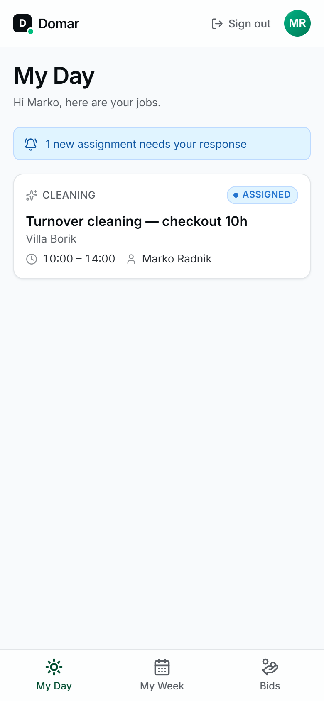
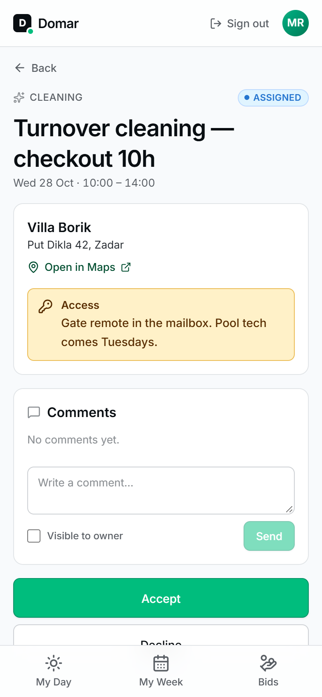

# Guide for workers

Domar is built to be used on your phone, between apartments. Open it in your
phone's browser, or use the Android app (see [The app](#the-app)).

The tabs at the bottom: **My Day**, **My Week** and **Bids**.

  
  &nbsp;
  

## My Day and My Week

- **My Day** lists today's jobs in time order. If new jobs are waiting for
  your answer, a banner at the top tells you how many.
- **My Week** shows everything coming up, grouped by day.

Tap a job to open it.

## On the job page

You'll find:

- **Address** with an **Open in Maps** link for directions.
- **Access**: key-box code, parking, wifi, anything you need at the door.
- **Price**: what the job pays (fixed, or per hour).
- **Checklist**: what has to be done before you can finish.
- **Photos**: before, after and issue photos.
- **Comments**: messages with your supervisor (and sometimes the owner).

## Working a job, step by step

1. **Accept** or **Decline.** If you can't do a job, decline it and say why. Your
   supervisor will reassign it.
2. **Start job** when you arrive.
3. Take **before** photos if useful, then work through the **checklist** and tick
   off each item. Items marked **Photo required** need a photo before they count.
4. If something is broken or missing, use **Flag an issue**: describe what's
   wrong and take a photo.
5. Take **after** photos.
6. **Finish job.** For hourly jobs, enter the **hours worked**; this is what
   you're billed and paid for. Add closing notes if there's anything to
   mention, then **Confirm finish**.

If **Finish job** is refused, check the message: usually a checklist item is
unticked or a required photo is missing.

## Bids

Some jobs don't have a price yet. They appear under **Bids** if they match
your skills. Propose a price, either fixed or per hour, and add a message if you
like. You can update or withdraw your bid while the job is still open.

If your bid is accepted, the job is assigned to you at your price and shows up
in *My Day* / *My Week*. Accept it there as usual.

## Photos

- **Camera** opens your phone camera; **Library** lets you pick an existing photo.
- JPEG, PNG and WebP are accepted, up to 15 MB. Large photos are shrunk
  automatically before upload, so this works fine on mobile data.
- **The property owner can see all photos on jobs at their property.** Don't
  photograph guests' belongings, documents or people.

## Comments

You see all comments on your jobs. Comments marked **Internal** are only for
the team; the owner never sees them.

When you write a comment, the **Visible to owner** checkbox decides who can
read it. Leave it unchecked for anything meant only for your supervisor.

## When a job comes back

If your supervisor **reopens** a finished job, it reappears in your list with
a note saying what needs to be redone.

## The app

The Domar Worker app for Android does everything the web version does for
workers, and adds:

- **Offline mode.** Jobs you've opened stay readable without a connection.
  Accepting, starting, finishing, ticking checklist items, comments and photos
  are saved on the phone and sent once you're back online.
- **Notifications**, if your company has set them up: you're notified when
  someone comments on one of your jobs.

Ask your supervisor how to install it. The app is for workers only;
supervisors and owners use the web version.
